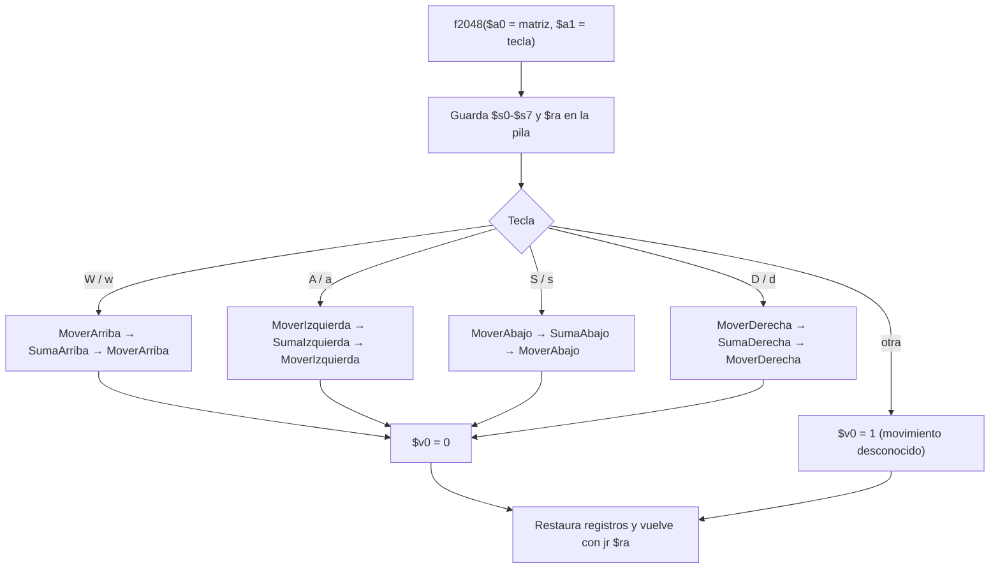

<div align="center">

# f2048

**El movimiento del juego 2048 escrito a mano en ensamblador MIPS: desplazar, fusionar y volver a desplazar un tablero de 4x4**


<sub>Fundamentos de Computadores · Grado en Ingeniería Informática · Universidad de Valladolid · Curso 2021-2022</sub>

</div>

Flujo de la subrutina `f2048`, tal y como está en `f2048.asm`:



## En pocas palabras

- **Reto**: implementar la regla central del 2048 (desplazar las fichas y fusionar las parejas iguales) sin un lenguaje de alto nivel, gestionando a mano registros, pila y memoria.
- **Solución**: una subrutina MIPS que recibe la matriz y la tecla, y combina subrutinas de desplazamiento y de suma para cada una de las cuatro direcciones.
- **Demuestra**: programación a bajo nivel, convenio de llamada MIPS, uso de la pila y descomposición modular en ensamblador.

## Lo más destacado

- **Patrón mover, sumar, mover**: cada dirección desplaza las fichas, suma las parejas iguales adyacentes y vuelve a desplazar para cerrar los huecos que deja la suma.
- **Convenio de llamada respetado**: cada subrutina reserva espacio en la pila y guarda los registros `$s` que usa y `$ra` antes de llamar a otras.
- **Ocho subrutinas especializadas**: `MoverDerecha`, `MoverIzquierda`, `MoverArriba`, `MoverAbajo` y `SumaDerecha`, `SumaIzquierda`, `SumaArriba`, `SumaAbajo`.
- **Acceso a la matriz encapsulado**: todas las lecturas y escrituras pasan por `LeeAij` y `EscAij` (dirección, fila, columna y valor).
- **Contrato claro**: acepta mayúsculas y minúsculas y devuelve en `$v0` un `0` si el movimiento es válido y un `1` si la tecla no corresponde a ningún movimiento.

## Interfaz

| Registro | Uso |
|----------|-----|
| `$a0` | Dirección de la matriz de 4x4 |
| `$a1` | Código ASCII de la tecla: `W`/`w` arriba, `A`/`a` izquierda, `S`/`s` abajo, `D`/`d` derecha |
| `$v0` | `0` si el movimiento es válido, `1` si la tecla es desconocida |

## Estructura del repositorio

```text
f2048/
└── f2048.asm   # Subrutina f2048 y sus subrutinas auxiliares
```

## Cómo ejecutarlo

Sin verificar. Se necesita un simulador MIPS (por ejemplo, MARS; el repositorio no indica cuál se usó). `f2048.asm` no se puede ensamblar solo, porque llama a `LeeAij` y `EscAij`, que no están en el repositorio. Para probarlo, ensámblalo junto al programa principal y a esas subrutinas, y llama a `f2048` con `$a0` apuntando a la matriz y `$a1` con la tecla.

## Estado y limitaciones

- El repositorio solo contiene la subrutina `f2048`. El programa principal que muestra el tablero y lee las teclas, y las subrutinas `LeeAij` y `EscAij`, no están incluidos.
- El fichero está codificado en ISO-8859-1, así que algunos acentos de los comentarios pueden verse mal en editores configurados en UTF-8.

## Autoría

Javier García (JavivuG), único autor de los commits del repositorio.

---

<div align="center"><sub>Parte de <a href="https://github.com/JavivuG/UVa-Projects">UVa-Projects</a> · Javier García González</sub></div>
